# Python 生存机器学习笔记

## 目录

- [实践流程](#workflow)
- [一、数据预处理](#preprocessing)
  - [1. 数据预处理的目的及重要性](#preprocessing-purpose)
  - [2. 数据理解和探索](#data-exploration)
  - [3. 数据清洗](#data-cleaning)
  - [4. 数据拆分](#data-splitting)
  - [5. 特征工程](#feature-engineering)
- [二、预测模型构建及调参](#modeling)
  - [1. 构建模型总览与超参数调优](#model-overview)
  - [2. Cox 比例风险模型](#cox-ph)
  - [3. 正则化 Cox 模型](#coxnet)
  - [4. 生存决策树模型](#survival-tree)
  - [5. 随机生存森林模型](#random-survival-forest)
  - [6. 生存梯度提升模型](#gradient-boosting-survival)
  - [7. 生存支持向量机模型](#survival-svm)
- [三、模型预测效果评价](#evaluation)
  - [1. 预测效果评价方式](#evaluation-overview)
  - [2. 一致性指数（C-index）](#concordance-index)
  - [3. 时间依赖 ROC 与动态 AUC](#time-dependent-roc-auc)
  - [4. 校准曲线](#calibration)
  - [5. 决策曲线分析（DCA）](#dca)
  - [6. Kaplan–Meier 生存曲线](#kaplan-meier)
  - [7. 预测效果评价总结](#evaluation-summary)
- [四、机器学习可解释性](#interpretability)
  - [1. 机器学习可解释性的由来](#interpretability-purpose)
  - [2. 机器学习可解释性方法](#interpretability-methods)
  - [3. SHAP 值及其计算](#shap-values)
  - [4. SHAP 特征重要性条形图](#shap-bar)
  - [5. SHAP 特征重要性蜂群图](#shap-beeswarm)
  - [6. SHAP 依赖性图](#shap-dependence)
  - [7. SHAP 瀑布图](#shap-waterfall)
  - [8. SHAP 力图](#shap-force)
  - [9. SHAP 图形总结](#shap-summary)

---

<a id="workflow"></a>
## 实践流程

**数据准备 → 构建模型 → 评估模型 → SHAP 可解释性分析。**

| 阶段 | 主要内容 |
| --- | --- |
| 数据准备 | 数据理解、清洗、拆分、标准化和变量筛选 |
| 构建模型 | 六种生存预测模型的训练与超参数调优 |
| 评估模型 | C-index、时间依赖 ROC/AUC、校准、DCA、KM 曲线 |
| SHAP | 条形图、蜂群图、依赖性图、瀑布图和力图 |

---

<a id="preprocessing"></a>
## 一、数据预处理

<a id="preprocessing-purpose"></a>
### 1. 数据预处理的目的及重要性

数据预处理的目的是检查和整理数据，使其能够用于模型训练。本项目主要包括：

**数据理解和探索 → 数据清洗 → 数据拆分 → 特征工程。**

数据拆分、异常值处理、缺失值插补和标准化的一般原理，可参考[二分类机器学习笔记的数据预处理部分](https://github.com/MinglongCheng/tabular-ml-binary-classification/blob/main/LEARNING_NOTES.md#preprocessing)。

<a id="data-exploration"></a>
### 2. 数据理解和探索

#### 2.1 生存数据的特点

**生存分析（Survival Analysis）**，也称**时间至事件分析（Time-to-event Analysis）**，用于研究从观察起点到目标事件发生的时间。**事件可以是死亡、疾病复发、再次住院等**。

生存数据通常包含：

| 内容 | 含义 |
| --- | --- |
| 生存时间（Survival Time） | 从观察起点到事件发生或最后观察的时间 |
| 事件状态（Event Indicator） | 是否观察到目标事件 |
| 协变量（Covariates） | 年龄、临床指标、治疗方式等预测特征 |

**右删失（Right Censoring）：** 观察结束时尚未记录目标事件，只知道患者在已经观察的时间内没有发生事件。

本项目的 `cens` 变量编码为：1 = 事件发生；0 = 右删失。

#### 2.2 数据查看

使用公开的 GBSG2 乳腺癌数据，共 686 名患者，包含八个预测特征。具体变量定义与数据来源见 [data/README.md](data/README.md)。

```python
# 导入数据
data = pd.read_csv("data/gbsg2_survival.csv", encoding="utf-8-sig", index_col=0)
print(data.head())  # 查看前五行
data.info()  # 查看数据结构
print(data['cens'].value_counts())  # 事件和删失频数
print(data['time'].describe())  # 观察时间分布
```

**观察时间直方图**

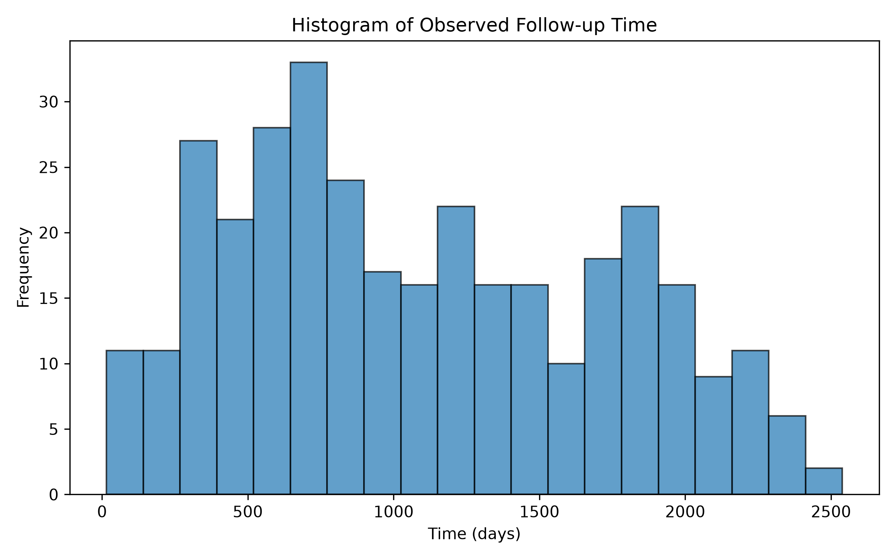

直方图展示患者实际观察时间的分布，既包含事件发生时间，也包含右删失时间。

<a id="data-cleaning"></a>
### 3. 数据清洗

本数据没有缺失值，因此主要进行数据完整性检查。

```python
missing_values = data.isnull().sum()  # 各变量缺失数
print(missing_values)
assert data.index.is_unique  # 检查患者编号
assert (data['time'] > 0).all()  # 观察时间必须大于0
assert data['cens'].isin([0, 1]).all()  # 事件状态只能为0或1
```

<a id="data-splitting"></a>
### 4. 数据拆分（Data Splitting）

| 数据集 | 用途 |
| --- | --- |
| 训练集（Training Set） | 预处理规则与模型拟合 |
| 验证集（Validation Set） | 选择模型超参数 |
| 测试集（Test Set） | 最终评价模型表现 |

```python
from sklearn.model_selection import train_test_split

development_data, test_data = train_test_split(
    data, test_size=0.3, stratify=data['cens'], random_state=2025
)
train_data, val_data = train_test_split(
    development_data, test_size=0.3,
    stratify=development_data['cens'], random_state=123
)
```

这里按事件状态 `cens` 分层拆分，最终得到训练集、验证集和测试集。`test_size`、`stratify` 等参数见[二分类笔记：数据拆分](https://github.com/MinglongCheng/tabular-ml-binary-classification/blob/main/LEARNING_NOTES.md#data-splitting)。

<a id="feature-engineering"></a>
### 5. 特征工程（Feature Engineering）

#### 5.1 连续变量标准化

本例对五个数值特征进行 Z-score 标准化（Standardization），使用训练集计算的参数转换验证集和测试集。

```python
from sklearn.preprocessing import StandardScaler

continuous_vars = ['age', 'tsize', 'pnodes', 'progrec', 'estrec']
scaler = StandardScaler()
train_data_scaled[continuous_vars] = scaler.fit_transform(train_data_scaled[continuous_vars])
val_data_scaled[continuous_vars] = scaler.transform(val_data_scaled[continuous_vars])
test_data_scaled[continuous_vars] = scaler.transform(test_data_scaled[continuous_vars])
```

标准化的作用及 `StandardScaler` 参数见[二分类笔记：特征工程](https://github.com/MinglongCheng/tabular-ml-binary-classification/blob/main/LEARNING_NOTES.md#feature-engineering)。

#### 5.2 Cox 变量筛选

本例使用训练集进行单因素与多因素 Cox 回归筛选，选出的变量用于普通 Cox 预测模型；其他五种模型使用全部八个候选特征。

```python
from lifelines import CoxPHFitter

cph = CoxPHFitter()
cph.fit(df_temp, duration_col='time', event_col='cens')  # 单因素Cox

cph_multi = CoxPHFitter()
cph_multi.fit(df_multi, duration_col='time', event_col='cens')  # 多因素Cox
```

`CoxPHFitter` 的回归结果可以查看系数、HR（Hazard Ratio）、95% CI 和 P 值。完整筛选代码见 [main.py](main.py)。

---

<a id="modeling"></a>
## 二、预测模型构建及调参

<a id="model-overview"></a>
### 1. 构建模型总览与超参数调优

#### 1.1 构建模型总览

| 模型（英文名称） | 简称 | Python 实现 |
| --- | --- | --- |
| Cox 比例风险模型（Cox Proportional Hazards Model） | Cox | `CoxPHFitter` |
| 正则化 Cox 模型（Regularized Cox） | Coxnet | `CoxnetSurvivalAnalysis` |
| 生存决策树模型（Survival Tree） | Survival Tree | `SurvivalTree` |
| 随机生存森林模型（Random Survival Forest） | RSF | `RandomSurvivalForest` |
| 生存梯度提升模型（Gradient Boosting Survival Analysis） | GBSA | `GradientBoostingSurvivalAnalysis` |
| 生存支持向量机模型（Survival Support Vector Machine） | Survival SVM | `FastSurvivalSVM` |

#### 1.2 什么是超参数调优？

超参数是模型训练前设定的参数，例如树的最大深度 `max_depth`、随机森林的树数量 `n_estimators`、正则化强度 `alpha`。

超参数调优用于控制模型复杂度、减少过拟合或欠拟合，并寻找适合数据的模型设定。

#### 1.3 常见超参数调优方法

| 方法 | 基本思路 |
| --- | --- |
| 网格搜索（Grid Search） | 遍历预设的参数组合 |
| 随机搜索（Random Search） | 随机抽取参数组合 |
| 贝叶斯优化（Bayesian Optimization） | 根据已有结果选择下一组参数 |
| 交叉验证（Cross Validation） | 通过多次拆分评价模型，可与搜索方法结合 |

本例使用**网格搜索**：在训练集拟合各候选模型，以验证集的 C-index 选择超参数，最后使用测试集评价。

<a id="cox-ph"></a>
### 2. Cox 比例风险模型（Cox Proportional Hazards Model）

#### 2.1 基本原理

Cox 模型是一种常用的半参数生存模型，主要研究多个风险因素对生存时间的影响。模型的基本形式为：

$$
h(t\mid X)=h_0(t)\exp(\beta_1X_1+\cdots+\beta_pX_p)
$$

| 符号 | 含义 |
| --- | --- |
| $h(t\mid X)$ | 个体在时刻 $t$ 的瞬时风险率（Hazard） |
| $h_0(t)$ | 基线风险函数（Baseline Hazard） |
| $X_j$ | 协变量 |
| $\beta_j$ | 回归系数 |
| $\exp(\beta_j)$ | 协变量增加一个单位对应的风险比（Hazard Ratio，HR） |

比例风险假设（Proportional Hazards Assumption）：在协变量固定时，不同患者的风险比不随时间变化；基线风险率本身可以随时间变化。

#### 2.2 优点

- **易于解释：** 可通过 HR 说明变量与事件风险的关系。
- **支持多变量分析：** 能同时考虑多个风险因素。
- **处理删失数据：** 能利用右删失患者已观察到的随访信息。

#### 2.3 缺点

- **比例风险假设：** 需要结合实际数据检查假设是否成立。
- **线性形式的限制：** 复杂的非线性关系可能需要额外建模。

#### 2.4 Python 函数与常用参数

```python
from lifelines import CoxPHFitter

model_cox = CoxPHFitter()
model_cox.fit(train_data_cox, duration_col='time', event_col='cens')
model_cox.summary  # 查看Cox回归结果
```

| 参数 / 方法 | 说明 |
| --- | --- |
| `duration_col` | 生存时间列 |
| `event_col` | 事件状态列，1 表示事件发生 |
| `penalizer` | 系数惩罚强度，普通 Cox 默认不加惩罚 |
| `summary` | 查看回归系数、HR、置信区间及 P 值 |
| `predict_partial_hazard()` | 预测相对风险得分 |
| `predict_survival_function()` | 预测生存函数 |

<a id="coxnet"></a>
### 3. 正则化 Cox 模型（Regularized Cox / Coxnet）

#### 3.1 基本原理

正则化 Cox 将 LASSO、Ridge 或 Elastic Net 等正则化方法与 Cox 模型结合，常用于变量较多或存在多重共线性的数据。

- **LASSO（L1）：** 可将部分回归系数压缩为 0，具有变量筛选作用。
- **Ridge（L2）：** 缩小回归系数，缓解共线性造成的不稳定。
- **Elastic Net：** 结合 L1 和 L2 两种惩罚。

#### 3.2 优点

- 可以自动收缩系数，LASSO 还可用于变量筛选。
- 有助于减少过拟合，提高模型稳定性。
- 能够处理右删失数据。

#### 3.3 缺点

- 正则化强度需要调参。
- 系数收缩可能引入偏差，模型仍受 Cox 比例风险结构限制。

#### 3.4 Python 函数与常用参数

```python
from sksurv.linear_model import CoxnetSurvivalAnalysis

penaltycox_model = CoxnetSurvivalAnalysis(
    l1_ratio=l1, alphas=[alpha], fit_baseline_model=True
)
penaltycox_model.fit(X_train, y_train)
```

| 参数 | 说明 |
| --- | --- |
| `l1_ratio` | L1 惩罚的比例；1 表示 LASSO，接近 0 时接近 Ridge |
| `alphas` | 正则化强度 |
| `fit_baseline_model` | 是否拟合基线模型，以支持生存函数预测 |
| `max_iter` | 最大迭代次数 |
| `tol` | 优化收敛容差 |

<a id="survival-tree"></a>
### 4. 生存决策树模型（Survival Tree）

#### 4.1 基本原理

生存决策树将决策树方法与生存分析结合，利用特征划分患者，并比较不同子节点的生存情况。

本例的分裂采用 **Log-rank** 准则：根据节点间生存时间及事件分布的差异进行划分。每个叶节点对应一个生存函数估计，可用于新患者的生存预测。

#### 4.2 优点

- 结构直观，便于理解预测规则。
- 能处理非线性关系和变量交互。
- 能处理右删失数据。

#### 4.3 缺点

- 容易过拟合，尤其在树较深时。
- 单棵树的结构对数据变化较敏感。

#### 4.4 Python 函数与常用参数

```python
from sksurv.tree import SurvivalTree

survtree_model = SurvivalTree(max_depth=depth,
                             min_samples_split=min_split,
                             min_samples_leaf=min_leaf,
                             random_state=123)
survtree_model.fit(X_train, y_train)
```

| 参数 | 说明 |
| --- | --- |
| `max_depth` | 最大树深度 |
| `min_samples_split` | 一个节点继续分裂所需的最少样本数 |
| `min_samples_leaf` | 叶节点中的最少样本数 |
| `random_state` | 随机种子 |

<a id="random-survival-forest"></a>
### 5. 随机生存森林模型（Random Survival Forest，RSF）

#### 5.1 基本原理

随机生存森林由多棵生存决策树构成，能够处理包含右删失记录的生存数据。

**建模过程：**

1. 从训练集进行 Bootstrap 有放回抽样，构建不同生存树。
2. 每次分裂时随机选择部分特征。
3. 汇总多棵树的预测，得到生存函数或风险得分。

#### 5.2 优点

- 能够拟合非线性关系和变量交互。
- 多棵树集成可提高模型稳定性。
- 支持右删失生存数据。

#### 5.3 缺点

- 计算量较大，训练多棵树需要更多时间。
- 模型解释不如 Cox 回归系数直观。

#### 5.4 Python 函数与常用参数

```python
from sksurv.ensemble import RandomSurvivalForest

survrf_model = RandomSurvivalForest(
    n_estimators=n_tree, max_depth=depth,
    min_samples_split=min_split, min_samples_leaf=min_leaf,
    max_features=max_feat, random_state=123, n_jobs=-1
)
survrf_model.fit(X_train, y_train)
```

| 参数 | 说明 |
| --- | --- |
| `n_estimators` | 生存树的数量 |
| `max_features` | 每次分裂时考虑的特征数或特征比例 |
| `max_depth` | 每棵树的最大深度 |
| `min_samples_split` | 节点继续分裂所需的最少样本数 |
| `min_samples_leaf` | 叶节点中的最少样本数 |
| `n_jobs` | 并行计算使用的进程／线程设置 |

<a id="gradient-boosting-survival"></a>
### 6. 生存梯度提升模型（Gradient Boosting Survival Analysis，GBSA）

#### 6.1 基本原理

生存梯度提升模型以生存决策树作为弱学习器，通过 Boosting 框架逐步优化生存损失函数，实现生存风险预测。

与随机森林不同，GBSA 依次增加树，每一棵树继续改进此前模型的预测结果。本例使用默认的 Cox 偏似然相关损失 `loss="coxph"`。

#### 6.2 优点

- 能够拟合复杂的非线性和交互关系。
- 通过逐步优化提高预测表现。
- 可以利用右删失信息。

#### 6.3 缺点

- 模型解释相对复杂。
- 学习率、树数量、树深度等参数需要调优。
- 多轮迭代可能带来较高的计算成本。

#### 6.4 Python 函数与常用参数

```python
from sksurv.ensemble import GradientBoostingSurvivalAnalysis

survgb_model = GradientBoostingSurvivalAnalysis(
    n_estimators=n_tree, learning_rate=lr, max_depth=depth,
    min_samples_split=min_split, min_samples_leaf=min_leaf,
    random_state=123
)
survgb_model.fit(X_train, y_train)
```

| 参数 | 说明 |
| --- | --- |
| `loss` | 生存损失函数，本例默认 `"coxph"` |
| `n_estimators` | 提升迭代次数／树的数量 |
| `learning_rate` | 学习率 |
| `max_depth` | 基学习器的最大深度 |
| `min_samples_split` | 最小分裂样本数 |
| `min_samples_leaf` | 最小叶节点样本数 |

<a id="survival-svm"></a>
### 7. 生存支持向量机模型（Survival Support Vector Machine，Survival SVM）

#### 7.1 基本原理

生存支持向量机将 SVM 的思想应用于生存数据，通过学习患者之间的生存顺序，预测相对风险。它支持右删失数据，尤其适用于风险排序任务。

本项目使用 `FastSurvivalSVM`，它包含排序目标和时间回归目标，`rank_ratio` 控制二者的比例。最终用于排序的模型不直接输出完整生存函数。

#### 7.2 优点

- 可以处理右删失数据。
- 适用于预测高低风险排序。
- 正则化可用于控制模型复杂度。

#### 7.3 缺点

- 不直接输出某个时间点的生存概率。
- 需要选择正则化参数，预测得分也不如 HR 直观。

#### 7.4 Python 函数与常用参数

```python
from sksurv.svm import FastSurvivalSVM

survsvm_model = FastSurvivalSVM(alpha=a, rank_ratio=rr, random_state=123)
survsvm_model.fit(X_train, y_train)
```

| 参数 | 说明 |
| --- | --- |
| `alpha` | 损失项的权重，控制相对正则化强度 |
| `rank_ratio` | 排序与时间回归目标的比例；1.0 为纯排序 |
| `max_iter` | 最大迭代次数 |
| `random_state` | 随机种子 |

---

<a id="evaluation"></a>
## 三、模型预测效果评价

<a id="evaluation-overview"></a>
### 1. 预测效果评价方式

| 方法 | 主要用途 |
| --- | --- |
| C-index | 评价风险排序的一致性 |
| 时间依赖 ROC / AUC | 评价不同随访时点的区分能力 |
| 校准曲线（Calibration Curve） | 比较预测生存概率与观察生存概率 |
| 决策曲线分析（DCA） | 计算不同风险阈值下的净收益 |
| Kaplan–Meier 曲线（KM） | 展示不同风险组的生存过程 |

<a id="concordance-index"></a>
### 2. 一致性指数（Concordance Index，C-index）

#### 2.1 概念与作用

C-index 是评价生存预测能力的常用指标，衡量模型预测的风险排序与实际事件先后顺序的一致性。

例如，A 比 B 更早发生事件，而模型也预测 A 的风险更高，这一患者对的排序就是正确的。

C-index 一般取值为 0–1：0.5 表示接近随机排序，越接近 1 表示排序越好。

#### 2.2 Python 函数与常用参数

```python
from sksurv.metrics import concordance_index_censored

cindex = concordance_index_censored(
    y_test['cens'], y_test['time'], pred_score
)[0]
```

| 参数 | 说明 |
| --- | --- |
| `event_indicator` | 事件状态，`True` 表示事件发生 |
| `event_time` | 观察时间 |
| `estimate` | 风险得分，数值越大表示预测事件风险越高 |

代码还采用 500 次 Bootstrap 重抽样估计 C-index 的 95% 置信区间，计算方法见 [main.py](main.py)。

#### 2.3 优点与局限

**优点：** 适用于不同的生存模型，可概括整体风险排序能力。

**局限：** 不反映某一固定时间点的预测概率是否准确。

<a id="time-dependent-roc-auc"></a>
### 3. 时间依赖 ROC 与动态 AUC（Time-dependent ROC / AUC）

#### 3.1 基本原理

ROC 曲线展示不同阈值下真正率（TPR）和假正率（FPR）的关系，AUC 是 ROC 曲线下面积。

生存数据包含右删失，因此可以使用时间依赖 ROC，在指定随访时间点评价模型的区分能力。

动态 AUC（Time-dependent AUC）则将多个时间点的 AUC 连接起来，观察模型区分能力随时间的变化。

#### 3.2 Python 函数与常用参数

```python
from sksurv.metrics import cumulative_dynamic_auc

risk_score = get_risk_score(survrf_model, X_test, model_type="Machine Survival")
auc_vals, mean_auc = cumulative_dynamic_auc(
    y_train, y_test, risk_score, times=eval_times
)
```

| 参数 / 返回值 | 说明 |
| --- | --- |
| `survival_train` | 用于估计删失分布的训练集生存结局 |
| `survival_test` | 需要评价的验证集或测试集生存结局 |
| `estimate` | 模型风险得分 |
| `times` | 需要计算 AUC 的时间点 |
| `auc_vals` | 各时间点的 AUC |
| `mean_auc` | 所选时间范围内的加权平均 AUC |

这里通过逆删失概率加权（Inverse Probability of Censoring Weighting，IPCW）处理右删失。

#### 3.3 动态 AUC 读图示例

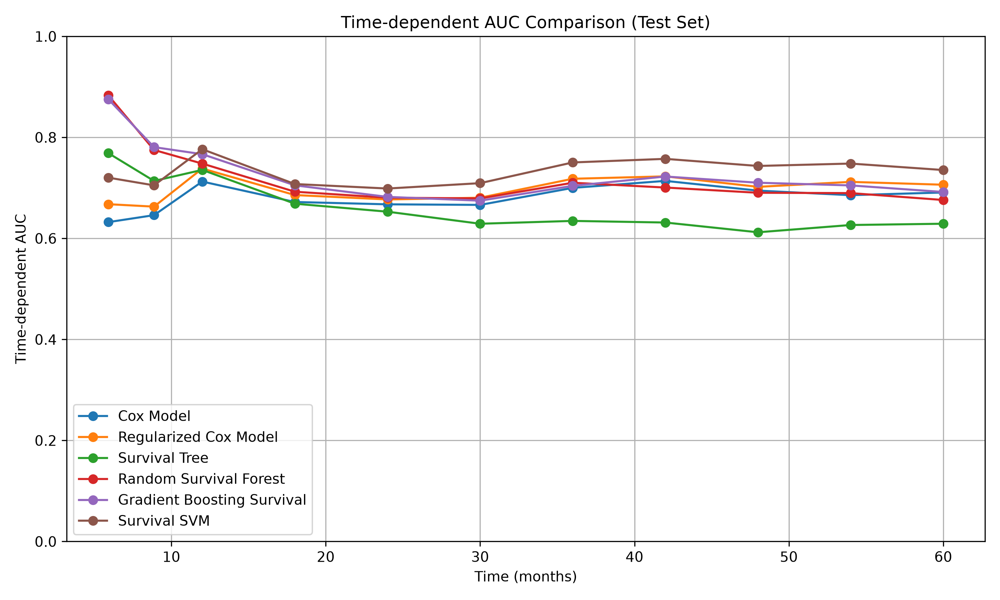

读图时，横轴为随访时间（月），纵轴为各时间点的 AUC；每条曲线代表一种生存模型。曲线越高，说明该模型在对应时点的区分能力越强。

本图中，部分模型在较早时点的 AUC 较高，之后有所下降；在约 2–5 年的范围内，各模型曲线相对平稳，但仍存在交叉。由此可以比较模型在不同随访时间点的区分能力。

#### 3.4 固定时间点 ROC

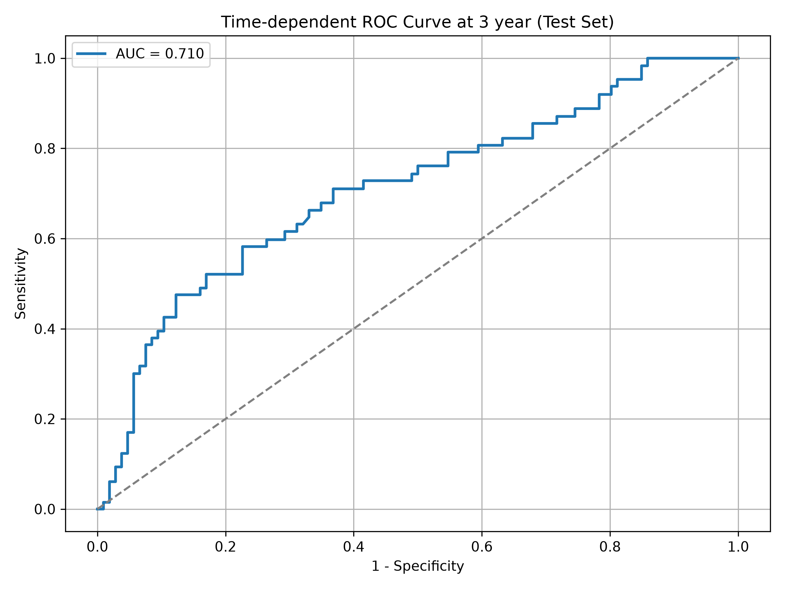

读图时，横轴为假正率（FPR），纵轴为真正率（TPR）。曲线整体越靠近左上角，区分能力越强；灰色对角虚线为随机区分的参考线。

本图为 RSF 在测试集上的三年 ROC，AUC 约为 0.710。蓝色曲线总体位于参考线上方，说明该模型在三年时点具有一定的区分能力。计算时，三年前删失者不纳入该时点的明确病例或对照，已观察到的病例使用 IPCW 加权。

<a id="calibration"></a>
### 4. 校准曲线（Calibration Curve）

#### 4.1 概念与作用

校准曲线将模型预测的生存概率与观察到的生存概率进行比较，用于评价预测概率的准确性。

本例预测三年生存概率，并按预测概率分组，用 Kaplan–Meier 方法估计各组实际观察到的三年生存概率。

#### 4.2 图形特点

| 图形元素 | 含义 |
| --- | --- |
| 横轴 | 平均预测生存概率 |
| 纵轴 | 观察生存概率（KM 估计） |
| 45° 参考线 | 预测概率与观察概率一致 |

#### 4.3 优点与局限

**优点：** 可以判断模型预测概率是否偏高或偏低。

**局限：** 小样本分组较少时，校准曲线可能不稳定。

#### 4.4 Python 函数与常用参数

```python
plot_calibration_curve_ml_test(
    model=survrf_model, X=X_test, y=y_test,
    time_point=365*3, n_groups=3,
    label="Random Survival Forest"
)
```

| 参数 | 说明 |
| --- | --- |
| `time_point` | 固定评价时点，本例为三年 |
| `n_groups` | 按预测概率划分的组数 |
| `KaplanMeierFitter` | 估计各组观察生存率 |

#### 4.5 校准曲线读图示例

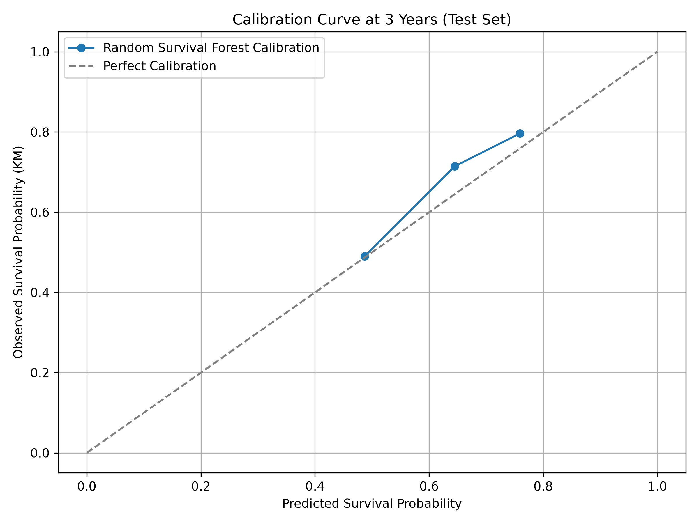

读图时，横轴为各组平均预测的三年无事件生存概率，纵轴为相应组通过 KM 估计的三年生存概率。点越接近灰色 45° 参考线，预测与观察越一致；位于线上方表示预测生存率偏低，下方则表示偏高。

本图中，RSF 的三个校准点中，预测生存概率约为 0.5 的分组接近参考线；另外两组位于参考线上方，说明其预测生存率略低于观察生存率。

<a id="dca"></a>
### 5. 决策曲线分析（Decision Curve Analysis，DCA）

#### 5.1 概念与作用

DCA 通过不同预测阈值下的净收益（Net Benefit），评价模型用于决策时的潜在价值。

在生存研究中，可以针对某个固定时间点的事件风险，比较依据模型采取行动、对所有人采取行动及不采取行动三种策略。

#### 5.2 图形中的三类曲线

| 曲线 | 含义 |
| --- | --- |
| 模型曲线 | 按模型预测的风险阈值进行决策 |
| Treat All | 所有人都接受相应行动 |
| Treat None | 所有人都不接受该行动，净收益为 0 |

#### 5.3 优点与局限

**优点：** 综合考虑预测结果和决策代价，便于比较不同模型。

**局限：** 需要合理的风险阈值范围，解释应结合具体决策场景。

#### 5.4 Python 函数与常用参数

```python
thresholds = np.linspace(0.01, 0.99, 100)
plot_dca_survival_test(
    model=survrf_model, X=X_test,
    time=y_test['time'], event=y_test['cens'],
    time_point=365*3,
    label="Random Survival Forest", model_type="ML Survival",
    thresholds=thresholds
)
```

| 参数 / 函数 | 说明 |
| --- | --- |
| `time_point` | 固定时间点，本例为三年 |
| `thresholds` | 预测事件概率的阈值 |
| `calculate_net_benefit_survival()` | 计算处理右删失后的净收益 |

#### 5.5 DCA 读图示例

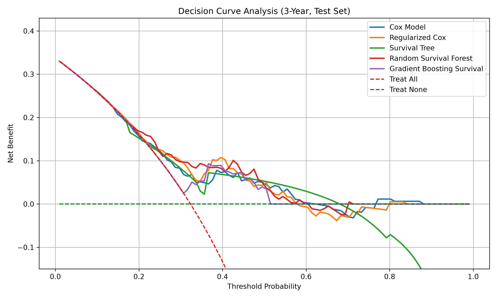

读图时，先在横轴选择一个阈值概率，再沿纵向比较各条曲线的净收益。绿色虚线（Treat None）的净收益为 0，红色虚线（Treat All）表示对所有患者采取行动；模型曲线同时高于两条参考线时，表示该阈值下依据模型决策的估计净收益更高。

本图中，在约 0.3–0.5 的部分阈值范围，多种模型的曲线高于两条参考线。模型曲线存在交叉，说明不同模型的净收益会随阈值变化。

<a id="kaplan-meier"></a>
### 6. Kaplan–Meier 生存曲线（Kaplan–Meier Curve，KM）

#### 6.1 概念与作用

Kaplan–Meier 曲线是一种非参数生存分析方法，通过逐步计算各事件时间点的生存概率，得到随时间变化的生存曲线，能够处理右删失数据。

本例根据模型的预测风险，将患者分为低、中、高风险组，再绘制各组的 KM 曲线。

#### 6.2 图形特点与解读

- 横轴：观察时间。
- 纵轴：无事件生存概率。
- 阶梯下降：相应时间点发生事件。
- Log-rank 检验：比较不同风险组的生存分布。

#### 6.3 Python 函数与常用参数

```python
from lifelines import KaplanMeierFitter
from lifelines.statistics import multivariate_logrank_test

kmf = KaplanMeierFitter()
kmf.fit(group_data['time'], event_observed=group_data['event'], label=group)
kmf.plot_survival_function(ci_show=False)
```

| 参数 / 函数 | 说明 |
| --- | --- |
| `durations` | 实际观察时间 |
| `event_observed` | 事件状态，1 表示事件发生 |
| `label` | 风险组名称 |
| `ci_show` | 是否显示置信区间 |
| `multivariate_logrank_test()` | 比较多个风险组的生存分布 |

#### 6.4 KM 读图示例

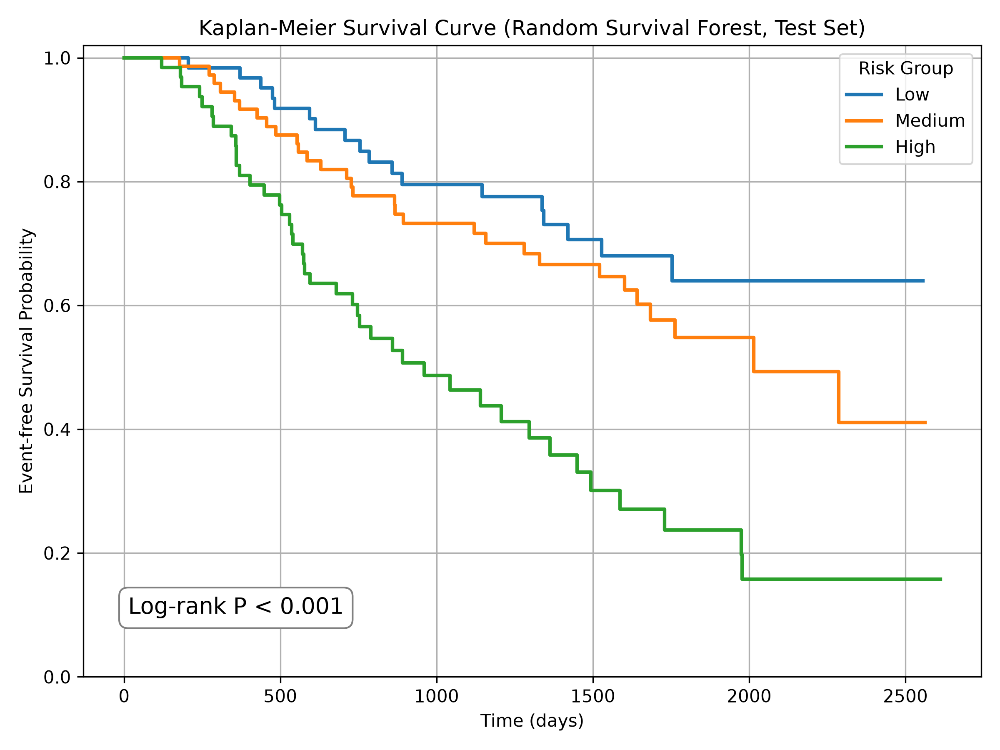

读图时，横轴为观察时间（天），纵轴为无事件生存概率。曲线每次阶梯式下降代表观察到事件；同一时间点，曲线越低表示该组估计的无事件生存概率越低。

本图中，高风险组（绿色）下降最快，低风险组（蓝色）整体最高，中风险组（橙色）介于两者之间。图中整体 Log-rank 检验为 P < 0.001，表示三组的观察生存分布存在差异。

<a id="evaluation-summary"></a>
### 7. 预测效果评价总结

| 图形 / 指标 | 主要用途 |
| --- | --- |
| C-index | 整体风险排序 |
| 时间依赖 ROC / AUC | 不同时间点的区分能力 |
| 校准曲线 | 预测概率是否与观察结果接近 |
| DCA | 不同阈值下的净收益 |
| KM 曲线 | 观察各预测风险组的生存分布 |

---

<a id="interpretability"></a>
## 四、机器学习可解释性

<a id="interpretability-purpose"></a>
### 1. 机器学习可解释性的由来

许多机器学习模型，例如随机森林和梯度提升模型，难以通过一个简单系数解释其预测过程，因此需要借助可解释性方法分析特征对预测的贡献。

<a id="interpretability-methods"></a>
### 2. 机器学习可解释性方法

| 方法 | 介绍 |
| --- | --- |
| SHAP（SHapley Additive exPlanations） | 基于 Shapley 值，为特征分配对预测结果的贡献，支持全局与局部解释 |
| LIME（Local Interpretable Model-agnostic Explanations） | 在局部范围使用简单模型近似原模型的预测 |
| 模型自身解释 | Cox 回归系数、HR、决策树结构等 |

下面重点介绍 SHAP。

<a id="shap-values"></a>
### 3. SHAP 值及其计算

#### 3.1 SHAP 值的含义

SHAP 为每个特征分配一个贡献值，用来表示该特征对某次模型预测的影响。

| 层次 | 含义 |
| --- | --- |
| 全局解释（Global Interpretation） | 汇总多个患者的特征贡献，了解整体重要性 |
| 局部解释（Local Interpretation） | 解释某位患者的预测由哪些特征共同形成 |

#### 3.2 Permutation SHAP

这里使用模型无关的 **Permutation Explainer**，通过改变特征的加入顺序估计各特征的 SHAP 贡献。

```python
import shap

background_data = shap.sample(X_train, min(30, len(X_train)), random_state=123)
explainer = shap.Explainer(
    model_predict, background_data, algorithm="permutation", seed=123
)
shap_values = explainer(
    X_test.iloc[:50], max_evals=3 * (2 * X_train.shape[1] + 1), silent=True
)
```

| 参数 | 说明 |
| --- | --- |
| `model_predict` | 模型预测函数 |
| `background_data` | 参考背景数据，本例从训练集抽取 30 名患者 |
| `algorithm="permutation"` | 使用 Permutation SHAP |
| `max_evals` | 控制近似解释的计算次数 |
| `shap_values` | 返回包含各样本特征贡献的解释对象 |

本仓库中，Cox、Coxnet、生存树、RSF、GBSA 解释**三年事件发生概率**；Survival SVM 解释**风险得分**。两类 SHAP 的输出单位不同。

<a id="shap-bar"></a>
### 4. SHAP 特征重要性条形图（Bar Plot）

#### 4.1 作用

提供全局特征重要性的简单展示，按照特征的平均绝对 SHAP 值排序。

#### 4.2 图形特点

| 图形元素 | 含义 |
| --- | --- |
| 横轴 | SHAP 值绝对值的平均值 |
| 纵轴 | 特征名称，按重要性排列 |
| 条形长度 | 平均贡献幅度 |

#### 4.3 图形解读

读图时，先看纵轴的特征排序，再看横轴的平均绝对 SHAP 值。条形越长，表示该特征在解释样本中的平均贡献幅度越大。

本图中，RSF 的 `pnodes` 排名第一，平均绝对 SHAP 值约为 0.07；`progrec` 和 `estrec` 次之，分别约为 0.06 和 0.03。这些数值反映对三年事件概率预测的平均贡献幅度，贡献方向需要结合蜂群图查看。

#### 4.4 Python 函数与常用参数

```python
shap.plots.bar(shap_values, max_display=15, show=False)
```

| 参数 | 说明 |
| --- | --- |
| `shap_values` | 多个样本的解释结果 |
| `max_display` | 最多展示的特征数 |
| `show` | 是否立即显示图形 |

#### 4.5 示例图

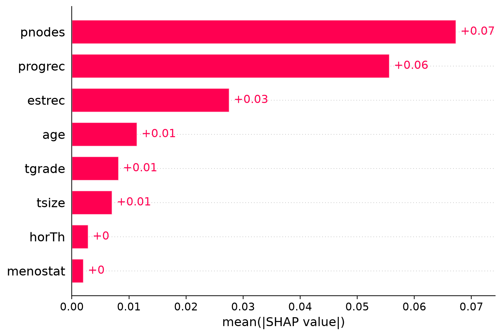

<a id="shap-beeswarm"></a>
### 5. SHAP 特征重要性蜂群图（Beeswarm Plot）

#### 5.1 作用

展示各特征对预测结果的贡献大小、正负方向，以及不同样本间的差异。

#### 5.2 图形特点

| 图形元素 | 含义 |
| --- | --- |
| 每个点 | 一个样本在该特征上的 SHAP 贡献 |
| 横轴 | SHAP 值，左侧负向、右侧正向 |
| 纵轴 | 特征名称 |
| 点的颜色 | 特征值大小，通常红色较高、蓝色较低 |

#### 5.3 图形解读

读图时，以横轴的 SHAP = 0 为界：右侧表示该特征提高三年事件概率预测，左侧表示降低预测。红色代表特征取值较高，蓝色代表取值较低；同一行的点越分散，表示该特征对不同患者的贡献差异越大。

本图中，`pnodes` 的高值（红色）主要位于右侧，低值（蓝色）多位于左侧；`progrec` 则相反，高值多在左侧，低值多在右侧。说明在当前 RSF 模型中，较多的阳性淋巴结通常提高预测风险，而较高的孕激素受体测定值通常降低预测风险。

#### 5.4 Python 函数与常用参数

```python
shap.plots.beeswarm(shap_values, max_display=15, show=False)
```

| 参数 | 说明 |
| --- | --- |
| `shap_values` | 多名患者的解释结果 |
| `max_display` | 最多展示的特征数 |
| `show` | 是否立即显示图形 |

#### 5.5 示例图

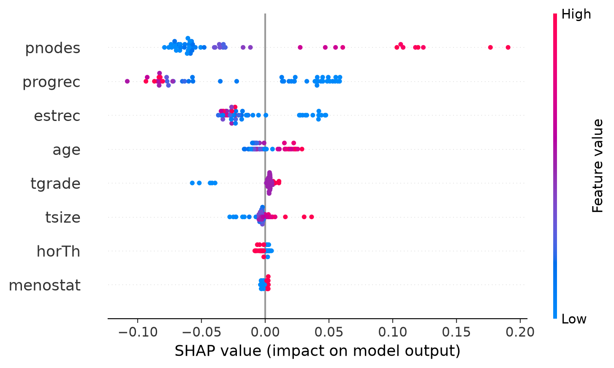

<a id="shap-dependence"></a>
### 6. SHAP 依赖性图（Dependence Plot）

#### 6.1 作用

展示某个特征的取值与对应 SHAP 贡献之间的关系，并使用另一特征的取值进行着色。

#### 6.2 图形特点

| 图形元素 | 含义 |
| --- | --- |
| 横轴 | 目标特征的取值 |
| 纵轴 | 目标特征的 SHAP 值 |
| 每个点 | 一名患者 |
| 颜色 | 另一个特征的取值 |

#### 6.3 图形解读

读图时，横轴为 `tgrade` 的取值，纵轴为该特征对三年事件概率的 SHAP 贡献；大于 0 表示提高预测，小于 0 表示降低预测。颜色表示另一特征 `progrec` 的取值。

本图中，`tgrade` 的 1 级样本多为负 SHAP 值，2 级大多接近 0，3 级多数为轻度正值。散点集中在 1、2、3 三个等级附近，可结合颜色观察不同 `progrec` 取值对应的分布。

#### 6.4 Python 函数与常用参数

```python
shap.plots.scatter(
    shap_values[:, 'tgrade'],
    color=shap_values[:, 'progrec'],
    show=False
)
```

| 参数 | 说明 |
| --- | --- |
| `shap_values[:, 'tgrade']` | 要绘制的特征 |
| `color` | 指定另一特征作为颜色 |
| `show` | 是否立即显示图形 |

#### 6.5 示例图

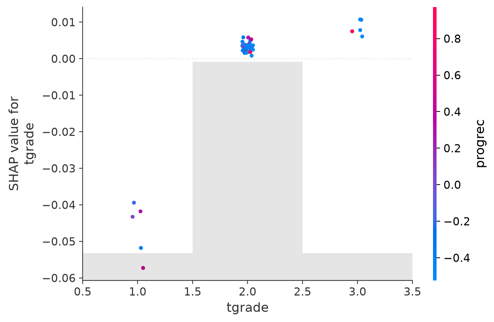

<a id="shap-waterfall"></a>
### 7. SHAP 瀑布图（Waterfall Plot）

#### 7.1 作用

解释单名患者的预测，展示各特征从参考预测值到最终预测值的累积贡献。

#### 7.2 图形特点

- 红色条形：提高模型预测值的贡献。
- 蓝色条形：降低模型预测值的贡献。
- 条形长度：贡献幅度。
- `E[f(X)]`：背景参考预测；`f(x)`：该患者的模型输出。

#### 7.3 图形解读

读图时，从下方的 `E[f(X)]` 出发，依次累加各特征的 SHAP 贡献，到达上方的 `f(x)`。红色提高三年事件概率预测，蓝色降低预测；条形越长，贡献幅度越大。

本图中，RSF 的背景预测概率约为 0.408，这名患者的预测概率约为 0.634。`pnodes` 的正向贡献约 +0.19，`progrec` 约 +0.05，是主要的推高因素。特征名称旁的 `2.733 = pnodes` 是标准化后的输入值，而红色条形上的 `+0.19` 才是 SHAP 贡献。

#### 7.4 Python 函数与常用参数

```python
obs_index = 5
shap.plots.waterfall(shap_values[obs_index], max_display=15, show=False)
```

| 参数 | 说明 |
| --- | --- |
| `shap_values[obs_index]` | 指定一名患者 |
| `max_display` | 最多展示的特征数量 |
| `show` | 是否立即显示图形 |

#### 7.5 示例图

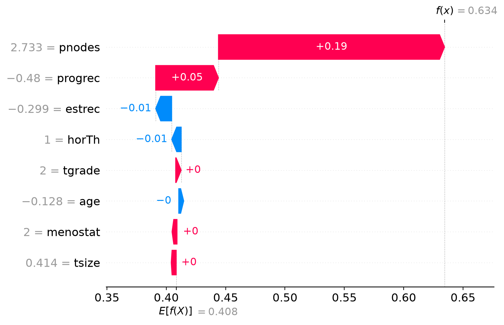

<a id="shap-force"></a>
### 8. SHAP 力图（Force Plot）

#### 8.1 作用

力图将各特征的正向和负向贡献集中展示，说明某个样本的预测值如何从背景值变化到最终结果，也可以排列多个样本进行比较。

#### 8.2 图形特点

- **单个样本：** 展示参考预测、最终预测和各特征的正负贡献。
- **多个样本：** 每个位置对应一个样本，可以观察不同患者的贡献组合。

#### 8.3 图形解读

**单个样本力图：** 先看 `base value` 和 `f(x)`，再看红蓝两侧的特征贡献。本图中，RSF 的背景三年事件概率约为 0.408，个体预测约为 0.634；`pnodes` 和 `progrec` 的红色区域将预测推高，蓝色区域则抵消了部分正向贡献，与瀑布图的结果一致。

**多个样本力图：** 横轴依次展示 50 名被解释患者，红色和蓝色区域分别表示正负贡献。区域宽度和分布随样本变化，可以比较不同患者的预测贡献；HTML 版本还可以查看单个患者的特征信息。

#### 8.4 Python 函数与常用参数

```python
force_plot_sig = shap.plots.force(shap_values[obs_index])  # 单个患者
shap.save_html(f"{save_path}force_plot_sig_{obs_index}_{model_name}.html", force_plot_sig)

# 多名患者的整体力图
base_value = float(np.mean(shap_values.base_values))
force_plot_all = shap.plots.force(
    base_value, shap_values.values,
    features=shap_values.data, feature_names=shap_values.feature_names
)
shap.save_html(f"{save_path}force_plot_all_{model_name}.html", force_plot_all)
```

| 参数 / 函数 | 说明 |
| --- | --- |
| `base_value` | 参考预测值 |
| `shap_values` | 一名或多名患者的 SHAP 贡献 |
| `features` | 特征取值 |
| `feature_names` | 特征名称 |
| `shap.save_html()` | 保存交互式 HTML 图 |

#### 8.5 示例图

**单个样本：**

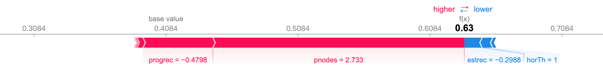

**50 名患者：**

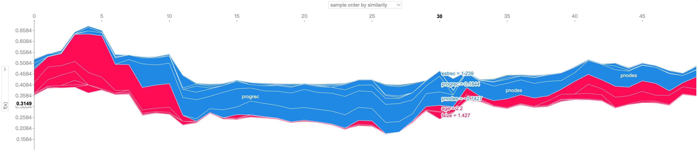

交互式版本：[单人力图](outputs/figures/shap/force_plot_sig_5_RSF.html) · [整体力图](outputs/figures/shap/force_plot_all_RSF.html)

<a id="shap-summary"></a>
### 9. SHAP 图形总结

| 图形 | 主要用途 |
| --- | --- |
| Bar Plot | 比较特征的重要性 |
| Beeswarm Plot | 展示特征贡献的大小和方向 |
| Dependence Plot | 查看特征取值与 SHAP 贡献的关系 |
| Waterfall Plot | 分解单个样本的预测 |
| Force Plot | 用正负贡献解释单个或多个样本的预测 |
