# Tabular Machine Learning for Survival Analysis

[](main.py)
[](pyproject.toml)

A Python workflow for data preparation, six-model comparison, performance evaluation, and SHAP interpretation using the publicly available **GBSG2 breast cancer dataset**.

**Survival analysis** (also called **time-to-event analysis**) studies the time from a defined starting point to an event of interest, such as **death**, **disease recurrence**, **hospital readmission**, or **treatment discontinuation**. It also accounts for **right-censored observations**, where the event has not been observed by the end of follow-up.

**[main.py](main.py) includes detailed Chinese comments throughout the analysis.** The [Chinese learning notes](LEARNING_NOTES.md) explain the methods, Python functions, parameters, and how to read the figures.

[What's included](#whats-included) · [Data and workflow](#data-and-workflow) · [Model evaluation](#model-evaluation) · [SHAP interpretation](#shap-interpretation) · [Run locally](#run-locally) · [Repository structure](#repository-structure)

## What's included

| Area | Methods and outputs |
| --- | --- |
| **Data exploration** | Predictor types, event/censoring frequencies, observed follow-up times, missingness checks, and a development/test descriptive table using `TableOne`. |
| **Data cleaning** | Checks for missing values, unique patient IDs, valid follow-up times, and event coding. The dataset has no missing values. |
| **Feature engineering** | Continuous-variable standardization with `StandardScaler`; univariable and multivariable Cox regression for feature screening. |
| **Six survival models** | Cox Proportional Hazards, Regularized Cox (Coxnet), Survival Tree, Random Survival Forest (RSF), Gradient Boosting Survival Analysis (GBSA), and Survival Support Vector Machine (SVM). |
| **Training and tuning** | Event-stratified training/validation/test splits, default-versus-tuned model comparison, validation C-index grid search, and model saving/loading. |
| **Numerical evaluation** | Concordance index (C-index) with 95% bootstrap confidence intervals and cumulative/dynamic time-dependent AUC. |
| **Evaluation plots** | Time-dependent AUC curves, three-year ROC and calibration curves, decision curve analysis (DCA), and Kaplan–Meier (KM) risk-group curves, for validation and test evaluation. |
| **SHAP interpretation** | Bar, beeswarm, dependence, waterfall, and single-/multiple-sample force plots, including interactive HTML outputs for all six models. |
| **Reproducible workflow** | Python 3.13.2, `uv.lock`, saved data splits and processed datasets, fitted models, CSV tables, and figures. |

## Data and workflow

[The GBSG2 dataset](data/gbsg2_survival.csv) contains **686 patients, eight predictors, and a right-censored recurrence-free survival outcome**. The `time` column records observed follow-up in days; `cens=1` indicates an observed event and `cens=0` indicates right censoring. See the [dataset documentation and variable dictionary](data/README.md).

| Split | Samples | Events | Right-censored |
| --- | ---: | ---: | ---: |
| Training | 336 | 146 | 190 |
| Validation | 144 | 63 | 81 |
| Test | 206 | 90 | 116 |

**Explore and check data → stratified split → standardize → select Cox features → train and tune → evaluate → explain.**

Standardization is fitted on the training predictors and applied to validation and test data. The ordinary Cox model uses two training-selected predictors (`pnodes` and `progrec`) on their original scale; the other five models use all eight predictors, with five numerical variables standardized.

The five non-Cox models use grid search on the fixed validation set, selecting parameters by C-index. Selected models are evaluated on the held-out test set without refitting on the combined development set.

<details>
<summary>Additional visualizations: Observed follow-up time (click to expand)</summary>

| Training set | Test set |
| --- | --- |
| 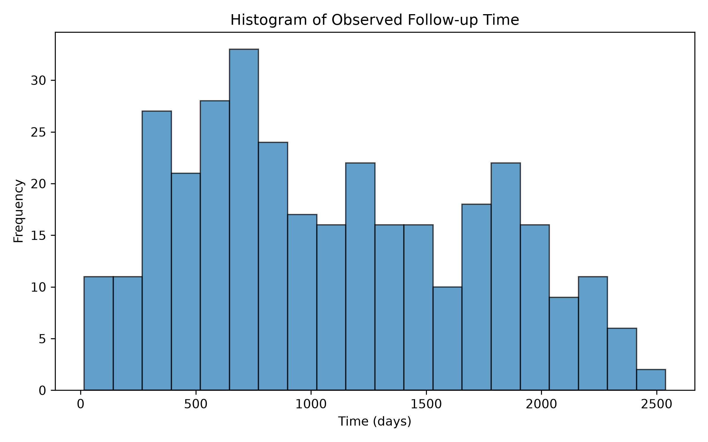 | 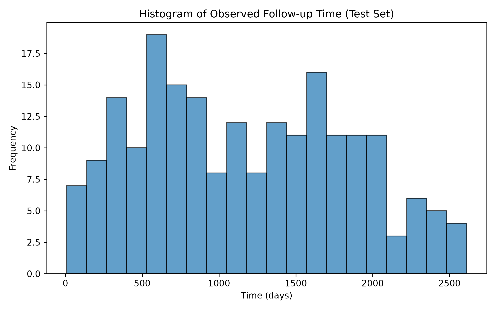 |

</details>

## Model evaluation

Test-set results (**n = 206**). C-index intervals use **500 patient-level bootstrap resamples** of the fixed model predictions. The time-dependent AUC is calculated at 11 follow-up times from 180 to 1,825 days; the three-year AUC refers to day 1,095.

| Model | C-index (95% CI) | 3-year AUC | Mean time-dependent AUC |
| --- | --- | ---: | ---: |
| Cox | 0.648 (0.589–0.703) | 0.700 | 0.681 |
| Regularized Cox (Coxnet) | 0.659 (0.598–0.714) | 0.718 | 0.697 |
| Survival Tree | 0.618 (0.563–0.674) | 0.635 | 0.655 |
| Random Survival Forest | 0.658 (0.605–0.713) | 0.710 | 0.702 |
| Gradient Boosting Survival | 0.665 (0.608–0.719) | 0.704 | 0.712 |
| Survival SVM | 0.681 (0.628–0.733) | 0.750 | 0.728 |

Full results: [validation C-index](outputs/tables/model_cindex_validation.csv) · [test C-index](outputs/tables/model_cindex_test.csv) · [validation time-dependent AUC](outputs/tables/model_time_auc_validation.csv) · [test time-dependent AUC](outputs/tables/model_time_auc_test.csv).

Random Survival Forest had the highest validation C-index (0.707) and mean time-dependent AUC (0.761), and is used for the single-model evaluation and SHAP examples. The comparison plots include all six models where supported; survival SVM does not provide survival probabilities for calibration or DCA.

<table>
  <tr>
    <th width="50%">Test time-dependent AUC · six models</th>
    <th width="50%">Random Survival Forest · test 3-year ROC</th>
  </tr>
  <tr>
    <td><a href="outputs/figures/evaluation/AUC_curves_allmodel_test.png">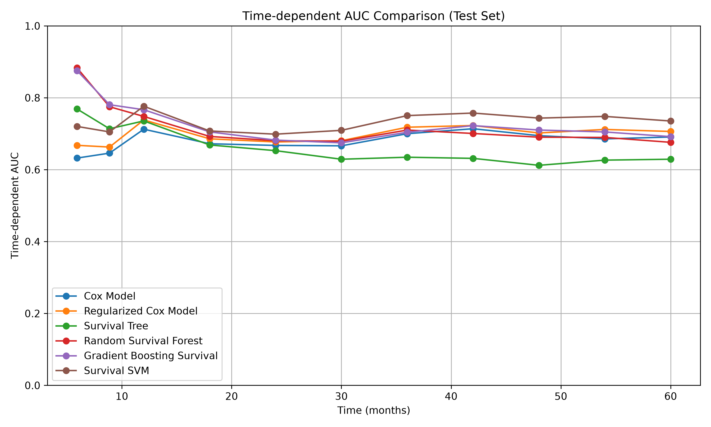</a></td>
    <td><a href="outputs/figures/evaluation/ROC_machine_survival_RandomSurvivalForest_test.png">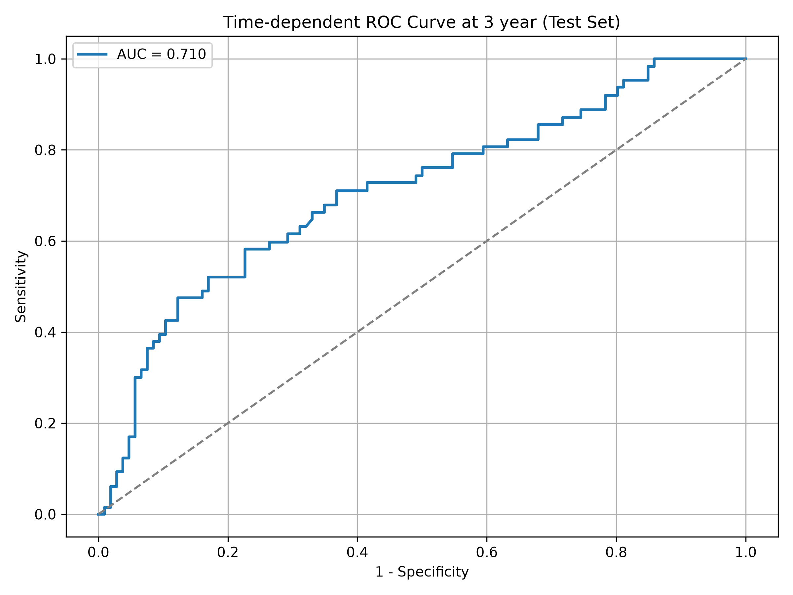</a></td>
  </tr>
</table>
<table>
  <tr>
    <th width="50%">Random Survival Forest · test 3-year calibration</th>
    <th width="50%">Test decision curves · five models</th>
  </tr>
  <tr>
    <td><a href="outputs/figures/evaluation/calibration_random_survival_forest_test.png">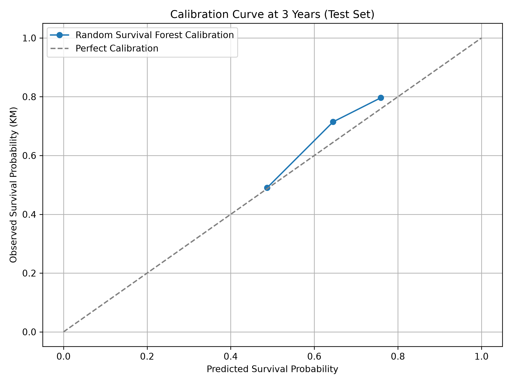</a></td>
    <td><a href="outputs/figures/evaluation/DCA_curves_allmodel_test.png">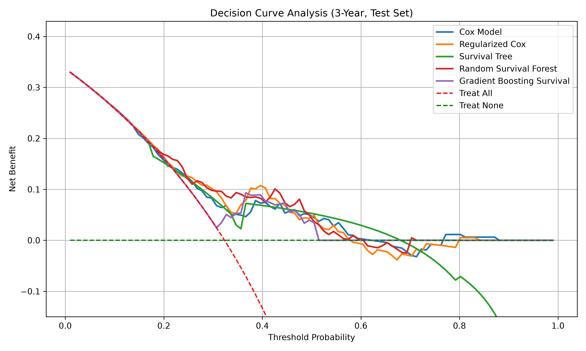</a></td>
  </tr>
</table>

<table width="100%">
  <tr>
    <th>Random Survival Forest · test Kaplan–Meier risk groups</th>
  </tr>
  <tr>
    <td align="center">
      <a href="outputs/figures/evaluation/KM_random_survival_forest_test.png">
        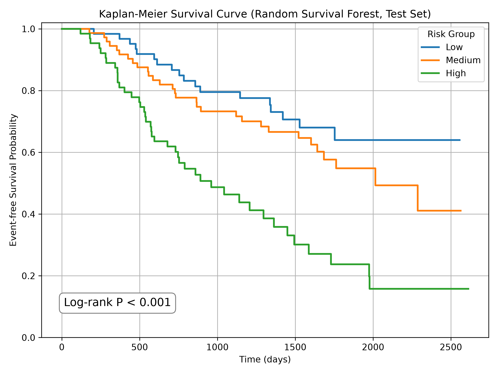
      </a>
    </td>
  </tr>
</table>

<details>
<summary>Additional visualizations: Validation-set figures (click to expand)</summary>

<table>
  <tr>
    <th width="50%">Validation time-dependent AUC curves</th>
    <th width="50%">Random Survival Forest · validation 3-year ROC</th>
  </tr>
  <tr>
    <td><a href="outputs/figures/evaluation/AUC_curves_allmodel_validation.png">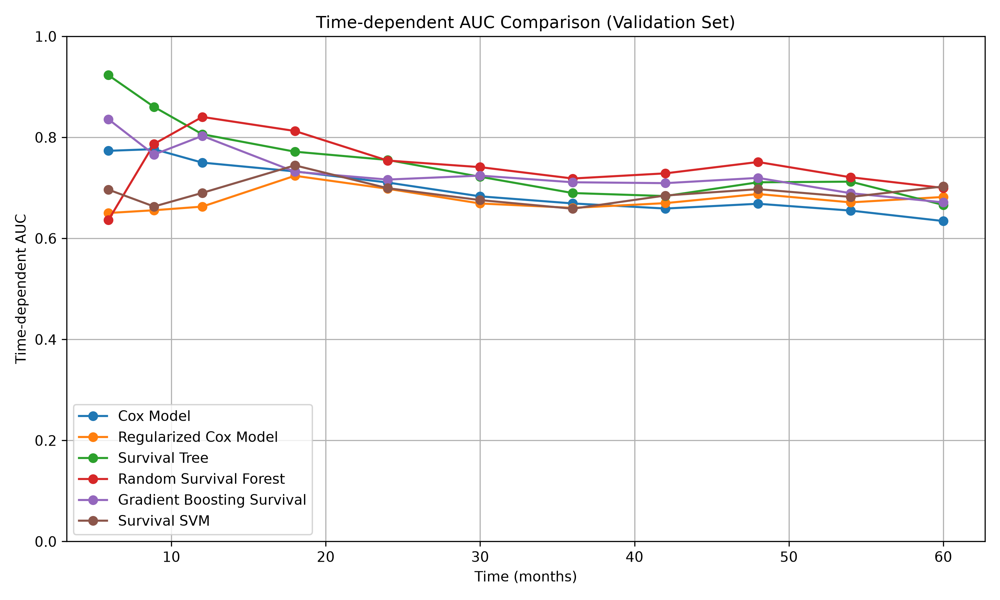</a></td>
    <td><a href="outputs/figures/evaluation/ROC_machine_survival_RandomSurvivalForest_validation.png">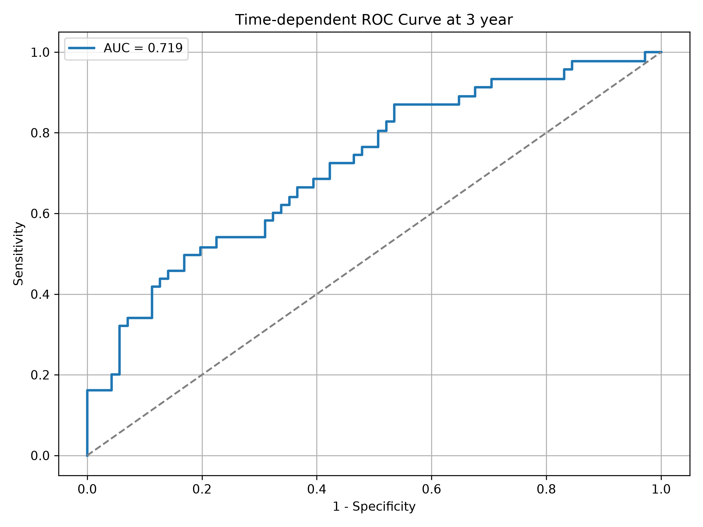</a></td>
  </tr>
</table>
<table>
  <tr>
    <th width="50%">Random Survival Forest · validation calibration</th>
    <th width="50%">Validation decision curves</th>
  </tr>
  <tr>
    <td><a href="outputs/figures/evaluation/calibration_random_survival_forest_validation.png">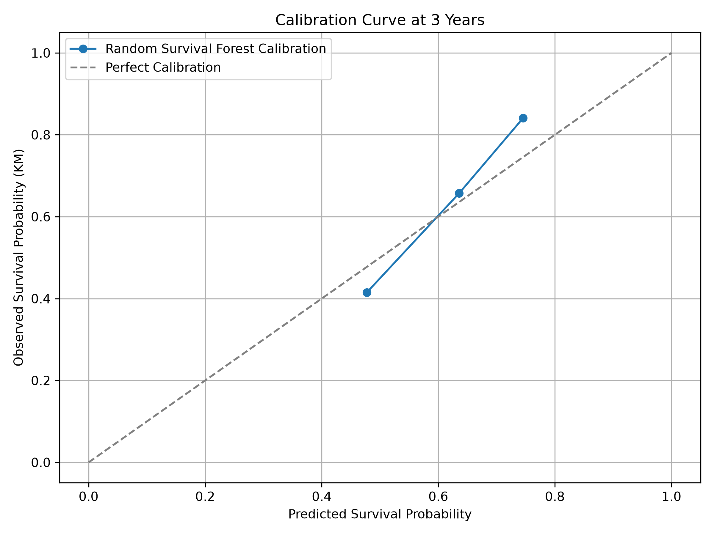</a></td>
    <td><a href="outputs/figures/evaluation/DCA_curves_allmodel_validation.png">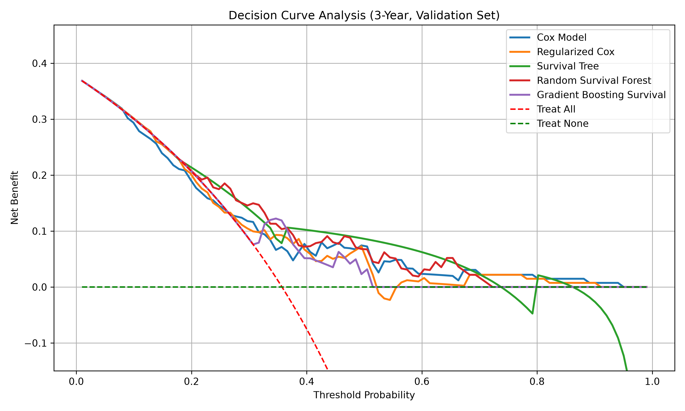</a></td>
  </tr>
</table>

<table width="100%">
  <tr>
    <th>Random Survival Forest · validation Kaplan–Meier risk groups</th>
  </tr>
  <tr>
    <td align="center">
      <a href="outputs/figures/evaluation/KM_random_survival_forest_validation.png">
        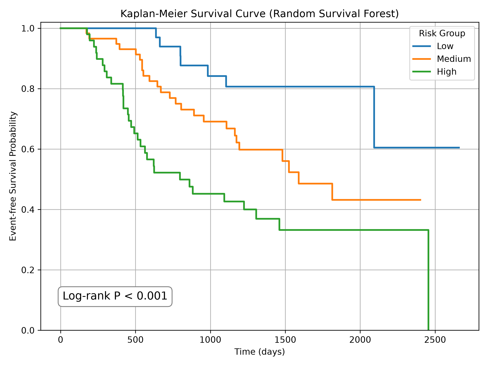
      </a>
    </td>
  </tr>
</table>

</details>

## SHAP interpretation

All six models are explained with **Permutation SHAP**, using **30 training-background samples** and the **first 50 test samples**. Cox, Coxnet, Survival Tree, RSF, and GBSA are explained on the **three-year event-probability scale**; Survival SVM is explained on its **risk-score scale**. Random Survival Forest examples cover every plot type below; [all-model outputs](outputs/figures/shap/) are also included.

<table>
  <tr>
    <th width="50%">Bar · global feature importance</th>
    <th width="50%">Beeswarm · contribution direction and distribution</th>
  </tr>
  <tr>
    <td><a href="outputs/figures/shap/bar_RSF.png">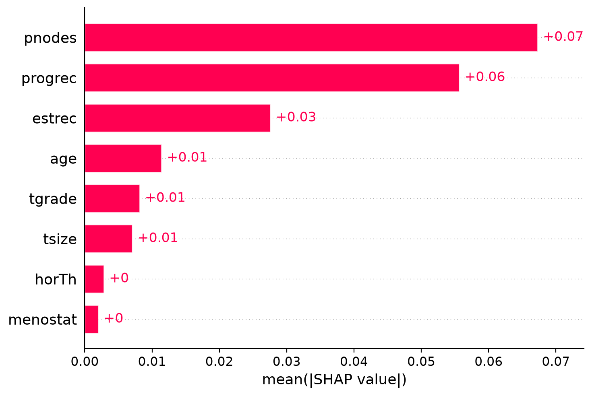</a></td>
    <td><a href="outputs/figures/shap/beeswarm_RSF.png">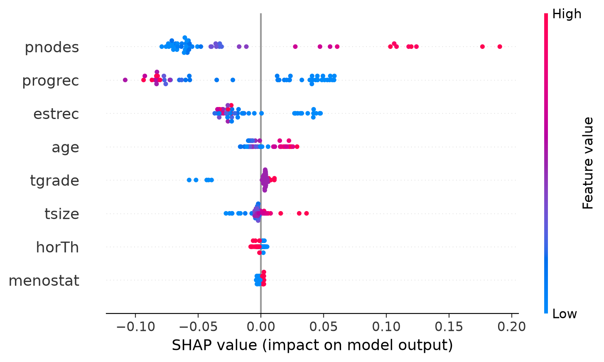</a></td>
  </tr>
</table>
<table>
  <tr>
    <th width="50%">Dependence · tgrade, colored by progrec</th>
    <th width="50%">Waterfall · one prediction</th>
  </tr>
  <tr>
    <td><a href="outputs/figures/shap/scatter_RSF.png">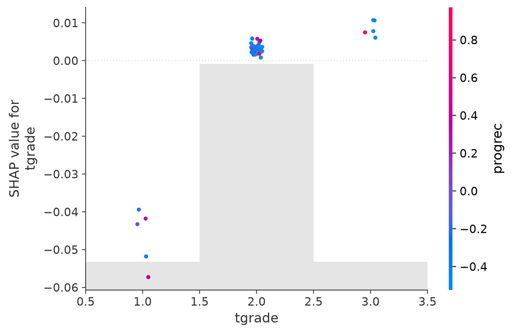</a></td>
    <td><a href="outputs/figures/shap/waterfall_5_RSF.png">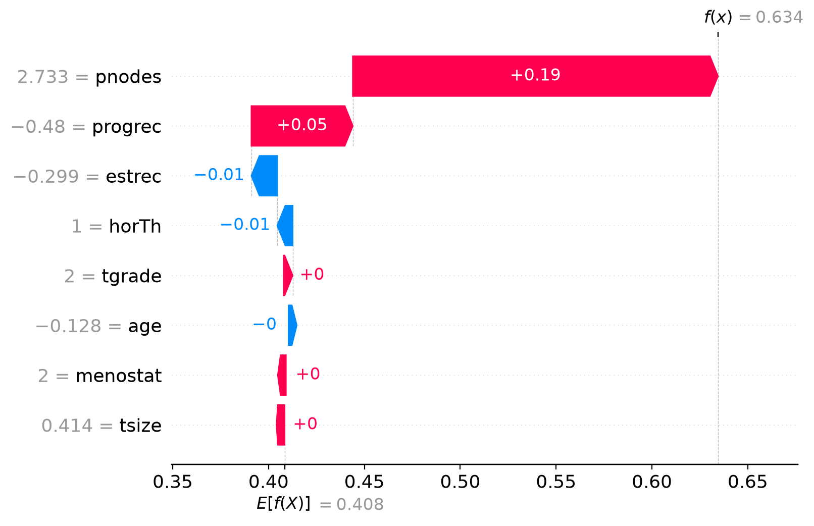</a></td>
  </tr>
</table>

**Force plot · one sample**

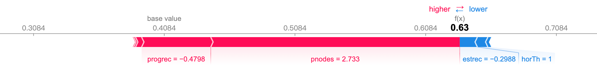

**Force plot · 50 samples**

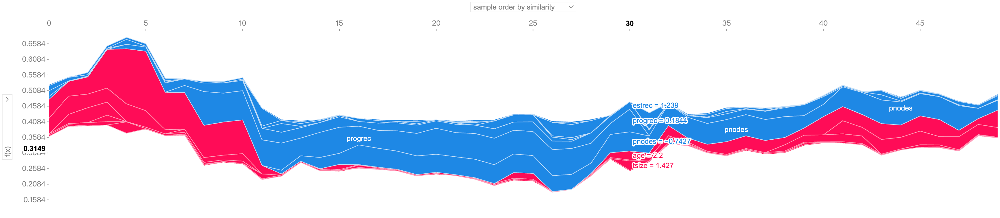

Interactive HTML: [one sample](outputs/figures/shap/force_plot_sig_5_RSF.html) · [50 samples](outputs/figures/shap/force_plot_all_RSF.html). Download and open in a browser to explore individual contributions. The PNG previews are browser captures of these HTML plots.

## Run locally

Python is pinned in [`.python-version`](.python-version); dependencies are declared in [`pyproject.toml`](pyproject.toml) and locked in [`uv.lock`](uv.lock).

With [uv](https://docs.astral.sh/uv/getting-started/installation/) installed, run from the repository root:

```bash
uv sync --locked
MPLBACKEND=Agg uv run --locked python main.py
```

`Agg` saves figures without opening plot windows. For Windows PowerShell:

```powershell
uv sync --locked
$env:MPLBACKEND = "Agg"
uv run --locked python main.py
```

The script writes processed data, fitted models, evaluation tables, comparison figures, and SHAP PNG/HTML files to `outputs/`. Each run includes model training and hyperparameter search and replaces generated files. The force-plot PNG screenshots are additional display assets.

For step-by-step exploration, follow the section headings and detailed Chinese comments in [main.py](main.py). The [learning notes](LEARNING_NOTES.md) provide the accompanying explanations and figure-reading guide.

## Repository structure

```text
tabular-ml-survival-analysis/
├── data/                               # Public GBSG2 dataset and data documentation
│   ├── gbsg2_survival.csv
│   └── README.md
├── outputs/                            # Data splits, fitted models, tables, and figures
│   ├── data_processed/
│   ├── data_splits/
│   ├── figures/
│   │   ├── evaluation/
│   │   └── shap/
│   ├── models/
│   ├── tables/
│   └── significant_vars.pkl
├── .gitattributes                      # Excludes generated SHAP HTML from language statistics
├── .gitignore                          # Excludes local environments and caches
├── .python-version                     # Python version (3.13.2)
├── LEARNING_NOTES.md                   # Chinese survival machine learning notes
├── README.md                           # Project overview and reproducibility guide
├── main.py                             # Complete analysis with detailed Chinese comments
├── pyproject.toml                      # Python project configuration and dependencies
└── uv.lock                             # Locked Python package dependencies
```
